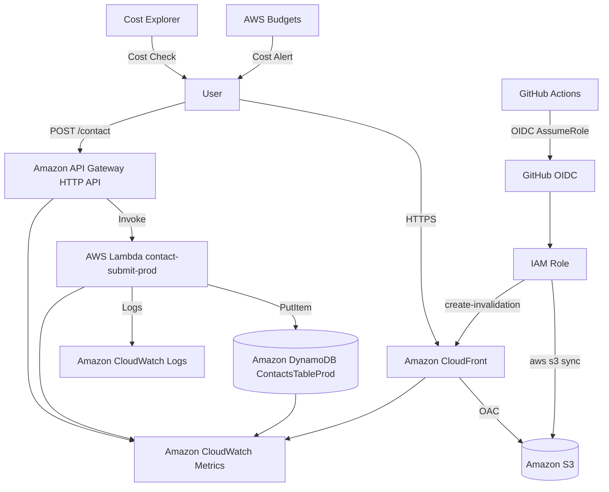

# AWS Cert Roadmap Lab

[English](README.md) | [繁體中文（台灣）](README.zh-TW.md) | [日本語](README.ja.md)

A portfolio web application for studying AWS certifications while learning to implement AWS serverless architectures.

The project turns AWS Cloud Practitioner and AWS Solutions Architect – Associate study material into a working learning website on AWS, rather than a collection of study notes.

## Current direction

The README is available in English, Taiwan Traditional Chinese, and Japanese, with README.md as the English main entry. Other development documentation, code comments, and Issue/PR descriptions are maintained in English. The learning website retains Japanese, English, and Traditional Chinese content, with Taiwan Traditional Chinese as the primary content priority. Existing language routes remain unchanged: Japanese at the root, English under `/en`, and Traditional Chinese under `/zh`.

The long-term goal is to expand beyond the current CLF/SAA material to cover all AWS certifications. This is a future content direction, not a claim that every certification is already covered. The MVP and phase-specific sections below retain their original scope and historical context.

---

## Overview

AWS Cert Roadmap Lab is a learning website for people studying AWS certifications.

Its main features are:

- Learning roadmaps for AWS Cloud Practitioner and SAA
- A glossary of major AWS services
- CLF-C02 practice questions
- AWS service comparison articles
- AWS architecture walkthroughs
- An AWS learning blog
- A contact form
- A serverless contact API

In the MVP, learning content is managed as static files. Only the contact form uses dynamic processing through API Gateway + Lambda + DynamoDB.

---

## Background

The project began while studying AWS Cloud Practitioner, with plans to take Solutions Architect – Associate next.

Rather than stopping at certification preparation, the aim is to implement what has been learned as real AWS architectures that can be explained in a portfolio.

This project emphasizes:

- Applying AWS certification knowledge in an implementation
- Keeping the AWS architecture inexpensive to operate
- Designing security, IAM, monitoring, and CI/CD together
- Expanding into a multilingual learning publication with global SEO while preserving existing Japanese pages

---

## Demo

Production URL:

```text
https://www.aws-cert-roadmap-lab.com/
```

The custom domain is now in use; the original MVP plan was to consider one after launch.

---

## Main features

### 1. Learning roadmap

Organizes the learning sequence from AWS Cloud Practitioner through Solutions Architect – Associate.

Topics:

- An overview of learning AWS
- The Cloud Practitioner exam scope
- Foundational knowledge for SAA
- Learning priorities by service
- AWS architectures understood through implementation

### 2. AWS glossary

Explains major AWS services and important concepts in a beginner-friendly format.

Initial coverage:

- IAM
- S3
- EC2
- Lambda
- VPC
- RDS
- DynamoDB
- CloudFront
- Route 53
- CloudWatch
- CloudTrail
- API Gateway
- SQS
- SNS
- EventBridge
- EBS
- EFS
- ELB
- Auto Scaling
- ACM
- KMS
- WAF
- AWS Budgets
- Cost Explorer
- Organizations
- AWS Config
- Secrets Manager
- Systems Manager
- CloudFormation
- Cognito

The MVP target is at least 30 glossary entries.

### 3. CLF-C02 practice questions

Provides practice questions for AWS Cloud Practitioner.

The MVP target is at least 30 questions.

Question categories:

| Category | Content |
|---|---|
| Cloud Concepts | Fundamental cloud concepts |
| Security and Compliance | Security and the shared responsibility model |
| Cloud Technology and Services | Major AWS services |
| Billing, Pricing, and Support | Billing, pricing, and support |

Each question includes:

- Question text
- Four answer choices
- The correct answer
- An explanation
- Related AWS services
- Related glossary entries

### 4. AWS service comparisons

Compares AWS services that are easy to confuse in exams and in practice.

Initial article examples:

- S3 vs. EBS vs. EFS
- EC2 vs. Lambda vs. ECS
- RDS vs. DynamoDB
- CloudWatch vs. CloudTrail vs. AWS Config
- SQS vs. SNS vs. EventBridge

### 5. AWS architecture walkthroughs

Explains architecture diagrams so learners understand how AWS services work together, rather than memorizing them individually.

Initial architecture examples:

- S3 + CloudFront static website
- API Gateway + Lambda + DynamoDB serverless API
- Private S3 content delivery through CloudFront OAC
- Low-cost operational monitoring with AWS Budgets + CloudWatch
- Authenticated API with Cognito + API Gateway + Lambda

### 6. Contact form

Stores contact form submissions through API Gateway + Lambda + DynamoDB.

Input fields:

- Name
- Email address
- Subject
- Message
- Honeypot field

The MVP uses a honeypot and input-length limits to reduce spam.

---

## Pages

| Page | URL | Content |
|---|---|---|
| Home | `/` | Site overview and main navigation |
| Learning roadmap | `/roadmap` | Learning sequence from CLF to SAA |
| AWS glossary | `/terms` | AWS service list |
| AWS glossary detail | `/terms/[termId]` | Service overview and exam points |
| Service comparisons | `/comparisons` | Comparison article list |
| Service comparison detail | `/comparisons/[comparisonSlug]` | Comparison of service differences |
| Practice question home | `/questions` | Navigation by question category |
| CLF question list | `/questions/clf` | CLF-C02 question list |
| Practice question detail | `/questions/[questionId]` | Answering questions and explanations |
| Architectures | `/architectures` | AWS architecture pattern list |
| Architecture detail | `/architectures/[architectureSlug]` | Architecture diagram and design explanation |
| Blog | `/blog` | AWS learning article list |
| Blog post | `/blog/[postSlug]` | SEO articles |
| Contact | `/contact` | Contact form |
| About | `/about` | Site operator information |
| Privacy policy | `/privacy` | Personal information and cookie policy |
| Disclaimer | `/disclaimer` | Disclaimers for learning and certification information |

## Multilingual support and global SEO

Japanese pages keep their existing URLs. English pages are published under `/en`, and Traditional Chinese pages under `/zh`. Pages are generated statically for each language, with learning content primarily managed in Markdown, MDX, and JSON. The project has not migrated to a translation API or a content database.

The main published pages include each language's home page, roadmap, glossary, practice questions, comparisons, architectures, blog, about, contact, privacy policy, and disclaimer. Translation scope and coverage vary by page and article.

SEO metadata uses a title, description, OGP metadata, and self-referencing canonical URL appropriate to each page's language. The multilingual sitemap includes each URL and reciprocal `ja` / `en` / `zh-Hant` hreflang relationships. Japanese pages continue to use their existing canonical URLs. There are no automatic redirects based on IP address or browser language.

Although multilingual pages have been published, search engine indexing and traffic by country and region still need ongoing verification. Publication alone does not guarantee inclusion in search results or international traffic.

---

## Technology stack

### Frontend

| Technology | Purpose |
|---|---|
| Next.js | Web application framework |
| TypeScript | Type-safe development |
| Tailwind CSS | UI styling |
| Markdown / MDX | Learning content management |
| JSON | Glossary and question data management |

### Backend

| Technology | Purpose |
|---|---|
| Python | Lambda implementation |
| AWS Lambda | Contact submission processing |
| API Gateway HTTP API | API exposure |
| DynamoDB | Contact data storage |

### AWS

| Service | Purpose |
|---|---|
| Amazon S3 | Static file hosting |
| Amazon CloudFront | CDN and HTTPS delivery |
| CloudFront OAC | Preventing direct public access to S3 |
| Amazon API Gateway | Exposing the contact API |
| AWS Lambda | Saving contact submissions |
| Amazon DynamoDB | Contact data storage |
| Amazon CloudWatch Logs | Inspecting Lambda logs |
| Amazon CloudWatch Metrics | Monitoring API / Lambda / DynamoDB |
| AWS Budgets | Cost monitoring |
| Cost Explorer | Reviewing costs by service |
| IAM | Least-privilege access management |

### CI/CD

| Technology | Purpose |
|---|---|
| GitHub Actions | CI/CD |
| GitHub OIDC | Secure AWS authentication integration |
| AWS CLI | S3 deployment and CloudFront invalidation |

---

## Architecture

### MVP architecture

```text
User
  ↓ HTTPS
CloudFront
  ↓ OAC
S3 Static Site

User
  ↓ POST /contact
API Gateway HTTP API
  ↓
Lambda contact-submit-function
  ↓ PutItem
DynamoDB ContactsTableProd
  ↓
CloudWatch Logs
```

### AWS architecture diagram



---

## AWS design decisions

### 1. S3 + CloudFront instead of EC2

This product is primarily static content.

It therefore uses static delivery with S3 + CloudFront rather than an always-running EC2 server.

Reasons:

- Easier to keep fixed costs low
- No server administration
- A good fit for static websites
- Fast delivery through CloudFront
- Directly relevant to AWS certification study

### 2. DynamoDB instead of RDS

The only data stored in the MVP is contact form submissions.

Complex relationships are unnecessary, so DynamoDB is used instead of RDS.

Reasons:

- A good fit for a serverless architecture
- Suitable for a small volume of contact submissions
- Low administrative overhead
- Easy to access directly from Lambda
- Easier to keep fixed costs low than with RDS

### 3. S3 is not publicly exposed

The S3 bucket is not directly public. CloudFront Origin Access Control restricts access to requests through CloudFront.

Goals:

- Prevent accidental public S3 exposure
- Centralize HTTPS delivery in CloudFront
- Simplify cache control
- Make the security design explicit

### 4. Keep dynamic APIs minimal

In the MVP, AWS glossary entries, practice questions, articles, and architectures are managed as static files.

Only the contact form uses an API.

Reasons:

- Build SEO-friendly static pages
- Reduce API calls
- Reduce AWS usage costs
- Keep the development scope small
- Prioritize getting the site published

---

## Backend / Lambda

The MVP uses AWS Lambda for the contact form API.

- Expose `POST /contact` through API Gateway
- Validate input in Lambda
- Use a honeypot field for basic spam prevention
- Save valid contact submissions to DynamoDB
- Inspect execution logs in CloudWatch Logs
- Restrict the IAM role to `dynamodb:PutItem` on `ContactsTableProd`

The design avoids writing personal information, such as full email addresses or complete contact messages, to CloudWatch Logs.

### Contact API

| Item | Value |
|---|---|
| Method | `POST` |
| Path | `/contact` |
| Authentication | None |
| Runtime | Python |
| Storage | DynamoDB `ContactsTableProd` |

### Example request

The Japanese example payload is retained to illustrate the existing localized contact flow.

```json
{
  "name": "山田太郎",
  "email": "taro@example.com",
  "subject": "S3の記事について",
  "message": "S3とEBSの違いについて質問があります。",
  "sourcePage": "/contact",
  "honeypot": ""
}
```

### Example success response

The response message below is the existing Japanese API message, not an English translation of the runtime response.

```json
{
  "success": true,
  "data": {
    "contactId": "contact-xxxxxxxx",
    "status": "new"
  },
  "message": "お問い合わせを受け付けました。",
  "requestId": "req-xxxxxxxx"
}
```

---

## CI/CD

### Policy

The repository uses `master` as the production branch.

MVP CI/CD covers automatic deployment of the frontend static website.

### CI

Pull requests and pushes run the following:

```text
checkout
  ↓
install dependencies
  ↓
lint
  ↓
typecheck
  ↓
build
```

Checks:

- ESLint passes
- TypeScript type checking passes
- The Next.js build succeeds
- Static output is generated in `out/`

The current CI workflow also runs `npm test` before the build.

### CD

Changes to `master` run the following:

```text
checkout
  ↓
install dependencies
  ↓
lint / typecheck / build
  ↓
AWS OIDC authentication
  ↓
S3 sync
  ↓
CloudFront invalidation
  ↓
verify the latest site at the CloudFront URL
```

### Values used by GitHub Actions

| Type | Name | Description |
|---|---|---|
| Secret or Variable | `AWS_ROLE_ARN` | IAM role ARN to assume |
| Variable | `AWS_REGION` | `ap-northeast-1` |
| Secret or Variable | `S3_BUCKET_NAME` | Deployment target S3 bucket name |
| Secret or Variable | `CLOUDFRONT_DISTRIBUTION_ID` | CloudFront distribution ID |
| Variable | `NEXT_PUBLIC_API_BASE_URL` | API Gateway URL |
| Variable | `NEXT_PUBLIC_SITE_URL` | Site URL |

### IAM permissions for GitHub Actions

GitHub Actions receives only the permissions needed to deploy the frontend.

Allowed operations:

- `s3:ListBucket`
- `s3:PutObject`
- `s3:DeleteObject`
- `cloudfront:CreateInvalidation`

Permissions not granted:

- `AdministratorAccess`
- `iam:*`
- `lambda:*`
- `dynamodb:*`
- `apigateway:*`
- `ec2:*`
- `rds:*`

---

## Security design

### S3 / CloudFront

- Enable S3 Block Public Access
- Do not expose S3 directly
- Use CloudFront OAC
- Allow only the CloudFront distribution in the bucket policy
- Redirect HTTP to HTTPS

### IAM

- Restrict the Lambda execution role to DynamoDB `PutItem`
- Restrict the GitHub Actions role to S3 deployment and CloudFront invalidation
- Do not create access keys for the root user
- Enable MFA for administrative users
- Avoid routine use of `AdministratorAccess`

### Lambda / API

- Validate input in Lambda
- Reduce spam submissions with a honeypot
- Prevent oversized input with length limits
- Restrict CORS to the production CloudFront origin
- Do not expose internal error details in responses

### Logging

Information that may be written to CloudWatch Logs:

- requestId
- contactId
- status
- error code
- validation error field

Information that must not be written to CloudWatch Logs:

- Complete email addresses
- Complete contact messages
- Authorization headers
- AWS access keys
- API keys
- JWTs

---

## Cost optimization

The MVP avoids services that tend to incur fixed costs.

### Services not used

- EC2
- RDS
- NAT Gateway
- ALB
- ECS
- EKS
- OpenSearch
- SageMaker
- WAF
- SES

### Low-cost policies

| Area | Policy |
|---|---|
| Frontend | Static delivery with S3 + CloudFront |
| API | Only `POST /contact` |
| Lambda | 128–256 MB, 3–5 second timeout |
| DynamoDB | Only `ContactsTableProd`, on-demand capacity |
| CloudWatch Logs | 14–30 days of retention |
| Images | Optimize to reduce S3 data transfer |
| Monitoring | Review AWS Budgets and Cost Explorer |

### Preventing unexpected charges

- Configure monthly budget alerts in AWS Budgets
- Review service-level costs in Cost Explorer
- Do not retain CloudWatch Logs indefinitely
- Do not create NAT Gateway, RDS, or ALB resources for the MVP
- Do not leave unused resources running

---

## Operational monitoring

The MVP focuses on the following rather than building a large monitoring platform:

- AWS Budgets
- CloudWatch Logs
- CloudWatch Metrics
- Cost Explorer
- GitHub Actions logs
- Manual availability checks

### Monitoring targets

| Target | Checks |
|---|---|
| CloudFront | Site rendering, 4xx / 5xx |
| S3 | File existence and absence of direct public access |
| API Gateway | 4xx / 5xx and request count |
| Lambda | Errors, Duration, Logs |
| DynamoDB | Contact persistence and ItemCount |
| CloudWatch Logs | No personal information in log output |
| AWS Budgets | Monthly costs and forecast overruns |
| GitHub Actions | CI/CD success or failure |

### Incident investigation order

```text
1. Check GitHub Actions logs
2. Check CloudFront rendering
3. Check S3 objects
4. Check API Gateway metrics
5. Check Lambda metrics
6. Check CloudWatch Logs
7. Check DynamoDB persistence
8. Check Cost Explorer / Budgets
```

---

## Local development

### Prerequisites

- Node.js LTS
- npm
- Git
- AWS CLI
- Python 3.11 or later

### Setup

```bash
git clone <repository-url>
cd aws-cert-roadmap-lab
cd frontend
npm ci
```

### Start the development server

```bash
cd frontend
npm run dev
```

### Lint

```bash
cd frontend
npm run lint
```

### TypeScript type checking

```bash
cd frontend
npm run typecheck
```

### Tests

```bash
cd frontend
npm test
```

### Build

```bash
cd frontend
npm run build
```

Static output is generated in `frontend/out/`.

---

## Deployment

### Manual deployment

```bash
cd frontend
npm run build
aws s3 sync ./out s3://<S3_BUCKET_NAME> --delete
aws cloudfront create-invalidation \
  --distribution-id <CLOUDFRONT_DISTRIBUTION_ID> \
  --paths "/*"
```

### Automatic deployment

When changes reach `master`, GitHub Actions runs:

```text
npm ci
npm run lint
npm run typecheck
npm run build
aws s3 sync ./out s3://<S3_BUCKET_NAME> --delete
aws cloudfront create-invalidation --paths "/*"
```

---

## MVP scope

### Included

- Home page
- Learning roadmap
- AWS glossary
- AWS glossary detail pages
- CLF-C02 practice questions
- Practice question answer UI
- AWS service comparison articles
- AWS architecture walkthroughs
- Blog articles
- Contact form
- Contact API
- DynamoDB persistence
- S3 + CloudFront publication
- CloudFront OAC
- AWS Budgets
- CloudWatch Logs
- GitHub Actions CI/CD
- README documentation

### Not included in the MVP

- Login
- Cognito
- Per-user learning history
- Saved accuracy statistics
- Review questions
- Daily question emails
- SES
- WAF
- RDS
- EC2
- NAT Gateway
- ALB
- AI-generated explanations
- Payments
- Paid memberships

---

## Planned extensions

### Phase 4: SEO and monetization preparation (ongoing)

- Check indexing and traffic through Search Console and analytics
- Expand content and improve internal links
- Continue monetization preparation, including AdSense; resubmission has not been confirmed

### Phase 5: Global SEO and localization (main routes published)

- Preserve Japanese URLs and publish English `/en` and Traditional Chinese `/zh` pages
- Check multilingual indexing and traffic by country and region
- Continue improving translation quality, content quality, and page coverage

### Phase 6: Learning application (future)

- Cognito login
- My page
- Saved answer history
- Accuracy display
- Weak-category analysis
- Review questions
- Question of the day
- Scheduled processing with EventBridge
- Notifications through SES
- Explore paid learning materials and features

---

## AWS concepts applied in the implementation

This project applies topics covered in AWS certification study to a working implementation.

| AWS learning topic | Implementation |
|---|---|
| Global infrastructure | CloudFront delivery |
| Storage | Static file storage in S3 |
| Compute | Serverless processing with Lambda |
| Databases | Contact persistence in DynamoDB |
| Networking | CloudFront / API Gateway |
| Security | Least-privilege IAM / OAC / CORS |
| Monitoring | CloudWatch Logs / Metrics |
| Cost management | AWS Budgets / Cost Explorer |
| Automation | GitHub Actions CI/CD |

---

## Portfolio highlights

### 1. Connecting certification study to implementation

AWS services learned during certification preparation are combined into a working web application.

The result can be published on AWS, rather than remaining a set of study notes.

### 2. Serverless architecture

API Gateway + Lambda + DynamoDB implement the contact API without an always-running server.

### 3. Security design

S3 is not exposed directly; the site uses CloudFront OAC.

IAM permissions are also minimized, with Lambda granted only DynamoDB `PutItem` for database access.

### 4. Cost optimization

The design avoids EC2, RDS, NAT Gateway, and ALB, and uses AWS Budgets and CloudWatch Logs retention settings to reduce the risk of unexpected charges.

### 5. CI/CD

GitHub Actions provides pull request validation and automatic deployment from `master`.

### 6. Future monetization design

The project anticipates expanding SEO articles, the AWS glossary, practice questions, and architecture walkthroughs, with possible extensions into AdSense and paid learning materials.

---

## Points to explain in an interview

### Why S3 + CloudFront?

A learning site built primarily from static content does not need an always-running EC2 instance.

Hosting static files in S3 and serving them over HTTPS through CloudFront provides a low-cost, fast, and secure publishing architecture.

### Why Lambda?

Contact processing does not require an always-running server.

API Gateway + Lambda keeps costs low at low traffic levels and removes server administration.

### Why DynamoDB?

The MVP stores only contact data.

It does not need a complex relational data model, so DynamoDB is used instead of RDS.

### Why GitHub OIDC?

It avoids storing long-lived AWS access keys in GitHub Secrets.

OIDC lets GitHub Actions assume an AWS IAM role with temporary credentials, reducing credential exposure risk.

### How are unexpected charges prevented?

The MVP avoids services that tend to incur fixed costs, such as EC2, RDS, NAT Gateway, and ALB.

AWS Budgets, Cost Explorer, and CloudWatch Logs retention settings also support operations that detect rising costs.

---

## Development roadmap

| Phase | Scope | Status |
|---|---|---|
| Phase 0 | Development preparation and design | Complete |
| Phase 1 | Static website MVP | Complete |
| Phase 2 | AWS publication and contact API | Complete |
| Phase 3 | CI/CD and operational monitoring | Implemented; ongoing operation |
| Phase 4 | SEO and monetization preparation | Ongoing; verifying search traffic and monetization |
| Phase 5 | Global SEO and localization | Main `/en` and `/zh` routes published; search and regional traffic under verification |
| Phase 6 | Learning application | Future |

---

## License

To be determined.
