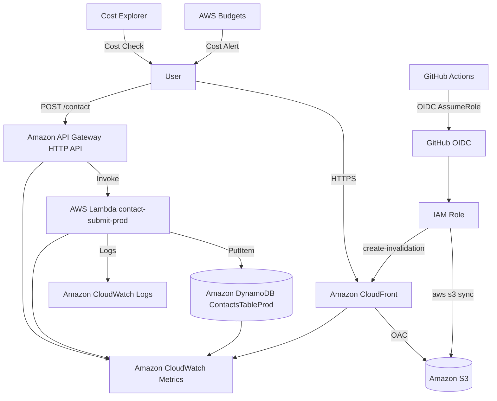

# AWS Cert Roadmap Lab

[English](README.md) | [繁體中文（台灣）](README.zh-TW.md) | [日本語](README.ja.md)

這是一個作品集 Web 應用程式，讓使用者在準備 AWS 認證的同時，透過實作學習 AWS 無伺服器架構。

本專案將 AWS Cloud Practitioner 與 AWS Solutions Architect – Associate 的學習內容，轉化為實際運作於 AWS 上的學習網站，而不只是學習筆記。

## 目前方向

README 提供英文、台灣繁體中文與日文三種版本，以 README.md 作為英文主要入口。其他開發文件、程式註解及 Issue／PR 說明均以英文維護。學習網站保留日文、英文與繁體中文教材，並以台灣繁體中文內容為優先。既有語言路由維持不變：日文位於根路徑，英文位於 `/en`，繁體中文位於 `/zh`。

長期目標是從目前的 CLF／SAA 教材擴大至全部 AWS 認證。這是未來的內容發展方向，不代表目前已涵蓋所有認證。以下 MVP 與各階段章節保留原始範圍及歷史脈絡。

---

## 概覽

AWS Cert Roadmap Lab 是為 AWS 認證學習者打造的學習網站。

主要功能包括：

- AWS Cloud Practitioner 與 SAA 學習路線圖
- AWS 主要服務詞彙表
- CLF-C02 模擬試題
- AWS 服務比較文章
- AWS 架構圖解
- AWS 學習部落格
- 聯絡表單
- 無伺服器聯絡 API

MVP 的學習內容以靜態檔案管理，只有聯絡表單透過 API Gateway + Lambda + DynamoDB 進行動態處理。

---

## 專案背景

本專案起始於準備 AWS Cloud Practitioner，並計畫接著報考 Solutions Architect – Associate 的時期。

目標是不只停留在認證準備，而是將所學實作為真正的 AWS 架構，並能在作品集中清楚說明。

本專案重視：

- 將 AWS 認證知識運用於實作
- 維持低營運成本的 AWS 架構
- 一併設計安全性、IAM、監控與 CI/CD
- 保留既有日文頁面，同時擴展為具備全球 SEO 的多語系學習媒體

---

## 線上展示

正式環境網址：

```text
https://www.aws-cert-roadmap-lab.com/
```

目前已使用自訂網域；原始 MVP 計畫是在上線後再考慮導入。

---

## 主要功能

### 1. 學習路線圖

整理從 AWS Cloud Practitioner 到 Solutions Architect – Associate 的學習順序。

涵蓋主題：

- AWS 學習全貌
- Cloud Practitioner 考試範圍
- 銜接 SAA 的基礎知識
- 各服務的學習優先順序
- 透過實作理解 AWS 架構

### 2. AWS 詞彙表

以適合初學者的方式說明 AWS 主要服務與重要概念。

初期收錄範圍：

- IAM
- S3
- EC2
- Lambda
- VPC
- RDS
- DynamoDB
- CloudFront
- Route 53
- CloudWatch
- CloudTrail
- API Gateway
- SQS
- SNS
- EventBridge
- EBS
- EFS
- ELB
- Auto Scaling
- ACM
- KMS
- WAF
- AWS Budgets
- Cost Explorer
- Organizations
- AWS Config
- Secrets Manager
- Systems Manager
- CloudFormation
- Cognito

MVP 目標是至少收錄 30 個詞條。

### 3. CLF-C02 模擬試題

提供 AWS Cloud Practitioner 模擬試題。

MVP 目標是至少 30 題。

試題類別：

| 類別 | 內容 |
|---|---|
| Cloud Concepts | 雲端基礎概念 |
| Security and Compliance | 安全性與共同責任模型 |
| Cloud Technology and Services | AWS 主要服務 |
| Billing, Pricing, and Support | 帳務、定價與支援 |

每道試題包含：

- 題目
- 四個選項
- 正確答案
- 解析
- 相關 AWS 服務
- 相關詞條

### 4. AWS 服務比較

比較考試與實務中容易混淆的 AWS 服務。

初期文章範例：

- S3 vs. EBS vs. EFS
- EC2 vs. Lambda vs. ECS
- RDS vs. DynamoDB
- CloudWatch vs. CloudTrail vs. AWS Config
- SQS vs. SNS vs. EventBridge

### 5. AWS 架構圖解

透過架構圖解說明 AWS 服務如何協同運作，協助學習者理解整體架構，而不只是個別背誦服務。

初期架構範例：

- S3 + CloudFront 靜態網站
- API Gateway + Lambda + DynamoDB 無伺服器 API
- 透過 CloudFront OAC 傳遞非公開 S3 內容
- AWS Budgets + CloudWatch 低成本營運監控
- Cognito + API Gateway + Lambda 具身分驗證的 API

### 6. 聯絡表單

透過 API Gateway + Lambda + DynamoDB 儲存聯絡表單提交內容。

輸入欄位：

- 姓名
- 電子郵件地址
- 主旨
- 訊息
- Honeypot 誘捕欄位

MVP 使用 honeypot 與輸入長度限制來減少垃圾訊息。

---

## 頁面一覽

| 頁面 | URL | 內容 |
|---|---|---|
| 首頁 | `/` | 網站概覽與主要導覽 |
| 學習路線圖 | `/roadmap` | 從 CLF 到 SAA 的學習順序 |
| AWS 詞彙表 | `/terms` | AWS 服務清單 |
| AWS 詞條詳情 | `/terms/[termId]` | 服務概覽與考試重點 |
| 服務比較 | `/comparisons` | 比較文章清單 |
| 服務比較詳情 | `/comparisons/[comparisonSlug]` | 比較服務差異 |
| 模擬試題首頁 | `/questions` | 依試題類別導覽 |
| CLF 試題清單 | `/questions/clf` | CLF-C02 試題清單 |
| 模擬試題詳情 | `/questions/[questionId]` | 作答與解析 |
| 架構清單 | `/architectures` | AWS 架構模式清單 |
| 架構詳情 | `/architectures/[architectureSlug]` | 架構圖與設計說明 |
| 部落格 | `/blog` | AWS 學習文章清單 |
| 部落格文章 | `/blog/[postSlug]` | SEO 文章 |
| 聯絡我們 | `/contact` | 聯絡表單 |
| 關於本站 | `/about` | 網站經營者資訊 |
| 隱私權政策 | `/privacy` | 個人資料與 Cookie 政策 |
| 免責聲明 | `/disclaimer` | 學習及認證資訊免責聲明 |

## 多語系支援與全球 SEO

日文頁面保留既有 URL，英文頁面發布於 `/en`，繁體中文頁面發布於 `/zh`。各語言頁面皆以靜態方式產生，學習內容主要使用 Markdown、MDX 與 JSON 管理。專案尚未改用翻譯 API 或內容資料庫。

目前已發布的主要頁面包含各語言的首頁、路線圖、詞彙表、模擬試題、服務比較、架構圖解、部落格、關於本站、聯絡我們、隱私權政策及免責聲明。翻譯範圍與涵蓋程度依頁面及文章而異。

SEO 中繼資料使用符合各頁面語言的標題、描述、OGP 中繼資料與指向自身的 canonical URL。多語系 sitemap 包含各 URL，以及互相對應的 `ja` / `en` / `zh-Hant` hreflang 關係。日文頁面繼續使用既有 canonical URL。不會根據 IP 位址或瀏覽器語言自動重新導向。

雖然多語系頁面已發布，仍需持續確認搜尋引擎索引狀態及各國家、地區的流量。發布頁面本身不保證被搜尋結果收錄或獲得海外流量。

---

## 技術組合

### 前端

| 技術 | 用途 |
|---|---|
| Next.js | Web 應用程式框架 |
| TypeScript | 型別安全的開發 |
| Tailwind CSS | UI 樣式 |
| Markdown / MDX | 學習內容管理 |
| JSON | 詞彙與試題資料管理 |

### 後端

| 技術 | 用途 |
|---|---|
| Python | Lambda 實作 |
| AWS Lambda | 聯絡表單提交處理 |
| API Gateway HTTP API | 對外提供 API |
| DynamoDB | 聯絡資料儲存 |

### AWS

| 服務 | 用途 |
|---|---|
| Amazon S3 | 靜態檔案託管 |
| Amazon CloudFront | CDN 與 HTTPS 傳遞 |
| CloudFront OAC | 防止直接公開存取 S3 |
| Amazon API Gateway | 對外提供聯絡 API |
| AWS Lambda | 儲存聯絡表單提交內容 |
| Amazon DynamoDB | 聯絡資料儲存 |
| Amazon CloudWatch Logs | 檢查 Lambda 日誌 |
| Amazon CloudWatch Metrics | 監控 API / Lambda / DynamoDB |
| AWS Budgets | 成本監控 |
| Cost Explorer | 檢視各服務成本 |
| IAM | 最小權限存取管理 |

### CI/CD

| 技術 | 用途 |
|---|---|
| GitHub Actions | CI/CD |
| GitHub OIDC | 安全的 AWS 身分驗證整合 |
| AWS CLI | S3 部署與 CloudFront 快取失效處理 |

---

## 架構

### MVP 架構

```text
User
  ↓ HTTPS
CloudFront
  ↓ OAC
S3 Static Site

User
  ↓ POST /contact
API Gateway HTTP API
  ↓
Lambda contact-submit-function
  ↓ PutItem
DynamoDB ContactsTableProd
  ↓
CloudWatch Logs
```

### AWS 架構圖



---

## AWS 設計決策

### 1. 使用 S3 + CloudFront，而非 EC2

本產品以靜態內容為主。

因此採用 S3 + CloudFront 靜態傳遞，而不是持續運作的 EC2 伺服器。

原因：

- 較容易壓低固定成本
- 不需管理伺服器
- 適合靜態網站
- 透過 CloudFront 快速傳遞內容
- 與 AWS 認證學習直接相關

### 2. 使用 DynamoDB，而非 RDS

MVP 唯一儲存的資料是聯絡表單提交內容。

不需要複雜的資料關聯，因此採用 DynamoDB 而非 RDS。

原因：

- 適合無伺服器架構
- 適合少量聯絡表單資料
- 管理負擔低
- 容易直接從 Lambda 存取
- 相較 RDS，較容易壓低固定成本

### 3. 不公開 S3

S3 儲存貯體不直接公開。透過 CloudFront Origin Access Control，將存取限制為經由 CloudFront 的請求。

目標：

- 防止意外公開 S3
- 將 HTTPS 傳遞集中於 CloudFront
- 簡化快取控制
- 明確呈現安全性設計

### 4. 將動態 API 維持在最少範圍

MVP 中的 AWS 詞條、模擬試題、文章與架構圖解均以靜態檔案管理。

只有聯絡表單使用 API。

原因：

- 建立對 SEO 友善的靜態頁面
- 減少 API 呼叫
- 降低 AWS 使用成本
- 維持較小的開發範圍
- 優先讓網站上線

---

## 後端 / Lambda

MVP 使用 AWS Lambda 實作聯絡表單 API。

- 透過 API Gateway 提供 `POST /contact`
- 在 Lambda 驗證輸入
- 使用 honeypot 欄位作為基本垃圾訊息防護
- 將有效的聯絡表單提交內容儲存至 DynamoDB
- 在 CloudWatch Logs 檢查執行日誌
- 將 IAM 角色限制為對 `ContactsTableProd` 執行 `dynamodb:PutItem`

設計上避免將完整電子郵件地址或完整聯絡訊息等個人資料寫入 CloudWatch Logs。

### 聯絡 API

| 項目 | 值 |
|---|---|
| 方法 | `POST` |
| 路徑 | `/contact` |
| 身分驗證 | 無 |
| 執行環境 | Python |
| 儲存位置 | DynamoDB `ContactsTableProd` |

### 請求範例

保留以下日文請求內容，以呈現既有的日文本地化聯絡流程。

```json
{
  "name": "山田太郎",
  "email": "taro@example.com",
  "subject": "S3の記事について",
  "message": "S3とEBSの違いについて質問があります。",
  "sourcePage": "/contact",
  "honeypot": ""
}
```

### 成功回應範例

以下訊息為既有 API 的日文回應，並非將執行時的回應翻譯為繁體中文。

```json
{
  "success": true,
  "data": {
    "contactId": "contact-xxxxxxxx",
    "status": "new"
  },
  "message": "お問い合わせを受け付けました。",
  "requestId": "req-xxxxxxxx"
}
```

---

## CI/CD

### 方針

此儲存庫使用 `master` 作為正式環境分支。

MVP 的 CI/CD 涵蓋前端靜態網站的自動部署。

### CI

Pull request 與 push 會執行以下流程：

```text
checkout
  ↓
安裝相依套件
  ↓
lint
  ↓
typecheck
  ↓
build
```

檢查項目：

- ESLint 通過
- TypeScript 型別檢查通過
- Next.js 建置成功
- 在 `out/` 產生靜態輸出

目前的 CI 工作流程也會在建置前執行 `npm test`。

### CD

變更合併至 `master` 後，會執行以下流程：

```text
checkout
  ↓
安裝相依套件
  ↓
lint / typecheck / build
  ↓
AWS OIDC 身分驗證
  ↓
S3 sync
  ↓
CloudFront invalidation
  ↓
透過 CloudFront URL 確認最新網站
```

### GitHub Actions 使用的設定值

| 類型 | 名稱 | 說明 |
|---|---|---|
| Secret or Variable | `AWS_ROLE_ARN` | 要擔任的 IAM 角色 ARN |
| Variable | `AWS_REGION` | `ap-northeast-1` |
| Secret or Variable | `S3_BUCKET_NAME` | 部署目標 S3 儲存貯體名稱 |
| Secret or Variable | `CLOUDFRONT_DISTRIBUTION_ID` | CloudFront 分佈 ID |
| Variable | `NEXT_PUBLIC_API_BASE_URL` | API Gateway URL |
| Variable | `NEXT_PUBLIC_SITE_URL` | 網站 URL |

### GitHub Actions 的 IAM 權限

GitHub Actions 僅取得部署前端所需的權限。

允許的操作：

- `s3:ListBucket`
- `s3:PutObject`
- `s3:DeleteObject`
- `cloudfront:CreateInvalidation`

不授予的權限：

- `AdministratorAccess`
- `iam:*`
- `lambda:*`
- `dynamodb:*`
- `apigateway:*`
- `ec2:*`
- `rds:*`

---

## 安全性設計

### S3 / CloudFront

- 啟用 S3 Block Public Access
- 不直接公開 S3
- 使用 CloudFront OAC
- 儲存貯體政策僅允許指定的 CloudFront 分佈存取
- 將 HTTP 重新導向 HTTPS

### IAM

- 將 Lambda 執行角色限制為 DynamoDB `PutItem`
- 將 GitHub Actions 角色限制為 S3 部署與 CloudFront 快取失效處理
- 不為 root 使用者建立存取金鑰
- 為管理使用者啟用 MFA
- 避免日常使用 `AdministratorAccess`

### Lambda / API

- 在 Lambda 驗證輸入
- 透過 honeypot 減少垃圾訊息提交
- 透過長度限制防止過大的輸入
- 將 CORS 限制為正式環境的 CloudFront 來源
- 不在回應中揭露內部錯誤細節

### 日誌

可以寫入 CloudWatch Logs 的資訊：

- requestId
- contactId
- status
- 錯誤代碼
- 驗證錯誤欄位

不得寫入 CloudWatch Logs 的資訊：

- 完整電子郵件地址
- 完整聯絡訊息
- Authorization 標頭
- AWS 存取金鑰
- API 金鑰
- JWT

---

## 成本最佳化

MVP 避免使用容易產生固定成本的服務。

### 不使用的服務

- EC2
- RDS
- NAT Gateway
- ALB
- ECS
- EKS
- OpenSearch
- SageMaker
- WAF
- SES

### 低成本方針

| 項目 | 方針 |
|---|---|
| 前端 | S3 + CloudFront 靜態傳遞 |
| API | 僅 `POST /contact` |
| Lambda | 128–256 MB，逾時時間 3–5 秒 |
| DynamoDB | 僅 `ContactsTableProd`，隨需容量 |
| CloudWatch Logs | 保留 14–30 天 |
| 圖片 | 最佳化以減少 S3 資料傳輸量 |
| 監控 | 檢視 AWS Budgets 與 Cost Explorer |

### 預防意外費用

- 在 AWS Budgets 設定每月預算警示
- 在 Cost Explorer 檢視各服務成本
- 不無限期保留 CloudWatch Logs
- MVP 不建立 NAT Gateway、RDS 或 ALB 資源
- 不讓未使用的資源持續運作

---

## 營運監控

MVP 不建立大型監控平台，而是著重以下項目：

- AWS Budgets
- CloudWatch Logs
- CloudWatch Metrics
- Cost Explorer
- GitHub Actions 日誌
- 手動可用性檢查

### 監控對象

| 對象 | 檢查項目 |
|---|---|
| CloudFront | 網站顯示、4xx / 5xx |
| S3 | 檔案是否存在，以及是否未直接公開 |
| API Gateway | 4xx / 5xx 與請求數 |
| Lambda | Errors、Duration、Logs |
| DynamoDB | 聯絡資料是否儲存，以及 ItemCount |
| CloudWatch Logs | 日誌輸出是否不含個人資料 |
| AWS Budgets | 每月成本與預測超支 |
| GitHub Actions | CI/CD 成功或失敗 |

### 事故排查順序

```text
1. 檢查 GitHub Actions 日誌
2. 檢查 CloudFront 網站顯示
3. 檢查 S3 物件
4. 檢查 API Gateway 指標
5. 檢查 Lambda 指標
6. 檢查 CloudWatch Logs
7. 檢查 DynamoDB 資料儲存
8. 檢查 Cost Explorer / Budgets
```

---

## 本機開發

### 先決條件

- Node.js LTS
- npm
- Git
- AWS CLI
- Python 3.11 或更新版本

### 環境設定

```bash
git clone <repository-url>
cd aws-cert-roadmap-lab
cd frontend
npm ci
```

### 啟動開發伺服器

```bash
cd frontend
npm run dev
```

### Lint

```bash
cd frontend
npm run lint
```

### TypeScript 型別檢查

```bash
cd frontend
npm run typecheck
```

### 測試

```bash
cd frontend
npm test
```

### 建置

```bash
cd frontend
npm run build
```

靜態輸出會產生於 `frontend/out/`。

---

## 部署

### 手動部署

```bash
cd frontend
npm run build
aws s3 sync ./out s3://<S3_BUCKET_NAME> --delete
aws cloudfront create-invalidation \
  --distribution-id <CLOUDFRONT_DISTRIBUTION_ID> \
  --paths "/*"
```

### 自動部署

變更進入 `master` 後，GitHub Actions 會執行：

```text
npm ci
npm run lint
npm run typecheck
npm run build
aws s3 sync ./out s3://<S3_BUCKET_NAME> --delete
aws cloudfront create-invalidation --paths "/*"
```

---

## MVP 範圍

### 包含項目

- 首頁
- 學習路線圖
- AWS 詞彙表
- AWS 詞條詳情頁
- CLF-C02 模擬試題
- 模擬試題作答 UI
- AWS 服務比較文章
- AWS 架構圖解
- 部落格文章
- 聯絡表單
- 聯絡 API
- DynamoDB 資料儲存
- S3 + CloudFront 發布
- CloudFront OAC
- AWS Budgets
- CloudWatch Logs
- GitHub Actions CI/CD
- README 文件

### MVP 不包含的項目

- 登入
- Cognito
- 個別使用者學習紀錄
- 儲存答對率統計
- 複習題
- 每日試題電子郵件
- SES
- WAF
- RDS
- EC2
- NAT Gateway
- ALB
- AI 產生的解析
- 付款
- 付費會員

---

## 後續擴充計畫

### Phase 4：SEO 與營利準備（進行中）

- 透過 Search Console 與流量分析確認索引狀態及流量
- 擴充內容並改善內部連結
- 持續進行包括 AdSense 在內的營利準備；尚未確認是否已重新申請

### Phase 5：全球 SEO 與在地化（主要路由已發布）

- 保留日文 URL，並發布英文 `/en` 與繁體中文 `/zh` 頁面
- 檢查多語系索引狀態，以及各國家與地區的流量
- 持續改善翻譯品質、內容品質及頁面涵蓋範圍

### Phase 6：學習應用程式（未來）

- Cognito 登入
- 個人頁面
- 儲存作答紀錄
- 顯示答對率
- 弱項類別分析
- 複習題
- 每日一題
- 透過 EventBridge 排程處理
- 透過 SES 傳送通知
- 探索付費教材與功能

---

## 實作中運用的 AWS 概念

本專案將 AWS 認證學習主題運用於可實際運作的系統。

| AWS 學習主題 | 實作方式 |
|---|---|
| 全球基礎設施 | CloudFront 內容傳遞 |
| 儲存 | 在 S3 儲存靜態檔案 |
| 運算 | Lambda 無伺服器處理 |
| 資料庫 | 在 DynamoDB 儲存聯絡資料 |
| 網路 | CloudFront / API Gateway |
| 安全性 | 最小權限 IAM / OAC / CORS |
| 監控 | CloudWatch Logs / Metrics |
| 成本管理 | AWS Budgets / Cost Explorer |
| 自動化 | GitHub Actions CI/CD |

---

## 作品集亮點

### 1. 連結認證學習與實作

將準備認證時學到的 AWS 服務，組合成可實際運作的 Web 應用程式。

成果能發布於 AWS，而不只是停留在學習筆記。

### 2. 無伺服器架構

透過 API Gateway + Lambda + DynamoDB 實作聯絡 API，不需要持續運作的伺服器。

### 3. 安全性設計

不直接公開 S3；網站使用 CloudFront OAC。

IAM 權限也採最小化設計，Lambda 的資料庫存取僅授予 DynamoDB `PutItem`。

### 4. 成本最佳化

設計上避免 EC2、RDS、NAT Gateway 與 ALB，並使用 AWS Budgets 及 CloudWatch Logs 保留期限設定，降低意外費用風險。

### 5. CI/CD

GitHub Actions 提供 pull request 驗證，以及從 `master` 自動部署的流程。

### 6. 未來營利設計

專案規劃擴充 SEO 文章、AWS 詞彙表、模擬試題與架構圖解，並可能進一步導入 AdSense 與付費教材。

---

## 面試可說明的重點

### 為什麼選擇 S3 + CloudFront？

以靜態內容為主的學習網站，不需要持續運作的 EC2 執行個體。

將靜態檔案託管於 S3，並透過 CloudFront 以 HTTPS 傳遞，即可建立低成本、快速且安全的發布架構。

### 為什麼使用 Lambda？

聯絡表單處理不需要持續運作的伺服器。

API Gateway + Lambda 在低流量時能維持低成本，並省去伺服器管理。

### 為什麼使用 DynamoDB？

MVP 只儲存聯絡資料。

不需要複雜的關聯式資料模型，因此採用 DynamoDB 而非 RDS。

### 為什麼使用 GitHub OIDC？

可避免將長期 AWS 存取金鑰儲存於 GitHub Secrets。

OIDC 讓 GitHub Actions 使用臨時憑證擔任 AWS IAM 角色，降低憑證外洩風險。

### 如何預防意外費用？

MVP 避免使用 EC2、RDS、NAT Gateway 與 ALB 等容易產生固定成本的服務。

AWS Budgets、Cost Explorer 與 CloudWatch Logs 保留期限設定，也有助於在營運過程中發現成本上升。

---

## 開發路線圖

| 階段 | 範圍 | 狀態 |
|---|---|---|
| Phase 0 | 開發準備與設計 | 已完成 |
| Phase 1 | 靜態網站 MVP | 已完成 |
| Phase 2 | AWS 發布與聯絡 API | 已完成 |
| Phase 3 | CI/CD 與營運監控 | 已實作；持續營運 |
| Phase 4 | SEO 與營利準備 | 進行中；確認搜尋流量與營利狀態 |
| Phase 5 | 全球 SEO 與在地化 | 主要 `/en` 與 `/zh` 路由已發布；搜尋與地區流量驗證中 |
| Phase 6 | 學習應用程式 | 未來 |

---

## 授權條款

待定。
