# AWS Certification Learning Site: AWS Architecture Design

## 1. Document Information

| Item | Details |
|---|---|
| Document name | AWS Certification Learning Site: AWS Architecture Design |
| Target product | AWS Cert Roadmap Lab |
| Target phases | MVP development through SAA preparation feature expansion, monetization preparation, and transition to a learning application |
| Purpose | Define the cloud architecture for a low-cost, highly available, extensible learning site on AWS |
| Intended users | The developer, recruiters, interviewers, and future maintainers |

---

## 2. Purpose of This Document

This document defines the architecture for building the AWS certification learning site, AWS Cert Roadmap Lab, on AWS.

The main objectives of this product are as follows.

1. Publish a learning site for AWS Cloud Practitioner / SAA
2. Put an AWS serverless architecture into practice and make it presentable as a portfolio
3. Keep operating costs as close to zero as possible
4. Enable future extensions for login, learning history, weakness analysis, advertising revenue, and paid learning-material sales

This document defines the minimum MVP architecture separately from the architecture for future expansion.

---

## 3. Basic Architecture Policy

## 3.1 Basic Policy

| Policy | Details |
|---|---|
| Serverless first | Avoid always-on EC2 and build primarily with S3, CloudFront, Lambda, API Gateway, and DynamoDB |
| Low-cost operation | Use Free Tier and pay-as-you-go services, aiming for effectively near-zero costs while traffic is low |
| Static content first | Use static generation as the default for the glossary, articles, comparison pages, and architecture diagrams |
| Minimum necessary APIs | In the MVP, create APIs only where needed, such as the contact form |
| Security focus | Do not expose S3 directly; serve through CloudFront. Use least-privilege IAM permissions |
| Extensibility | Allow future additions of Cognito, EventBridge, SES, and learning-history functionality |
| Portfolio value | Make service-selection rationale, architecture diagrams, cost design, and security design explainable |

---

## 4. Architecture Stages

Expand the AWS architecture in the following four stages.

| Phase | Architecture name | Objective | Main AWS services |
|---|---|---|---|
| Phase 1 | Static site publishing architecture | First publish the site on AWS | S3, CloudFront, IAM, AWS Budgets |
| Phase 2 | Serverless API architecture | Add APIs for contact submissions, question retrieval, etc. | API Gateway, Lambda, DynamoDB, CloudWatch |
| Phase 3 | SEO and monetization architecture | Support a custom domain, HTTPS, analytics, and advertising | Route 53, ACM, CloudFront, S3 |
| Phase 4 | Learning application architecture | Add login, learning history, weakness analysis, and notifications | Cognito, DynamoDB, EventBridge, SES, Lambda |

---

## 5. Phase 1: Static Site Publishing Architecture

## 5.1 Architecture Overview

In Phase 1, publish the website on AWS at minimum cost.

The content includes the following.

- Home page
- AWS glossary
- Service comparison pages
- Practice-question pages
- Architecture diagram pages
- Blog articles
- Site operator information
- Privacy policy
- Disclaimer

Generate content using Next.js static export or a static site generator such as Astro, and place it in S3.

---

## 5.2 Architecture Diagram

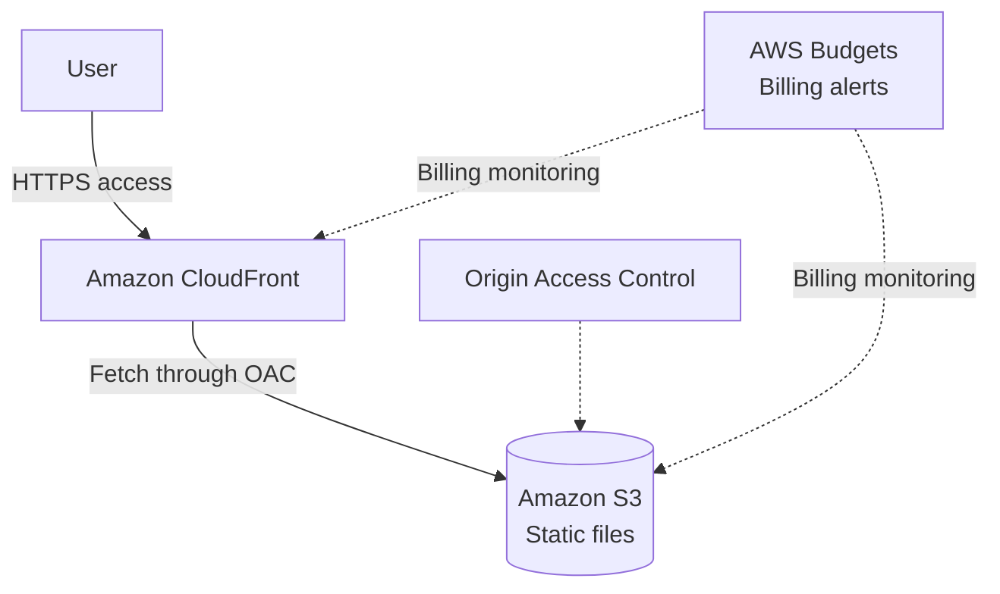

---

## 5.3 Service Configuration

| AWS service | Purpose | Reason for selection |
|---|---|---|
| Amazon S3 | Store static files | Low-cost storage for HTML, CSS, JavaScript, images, and architecture diagrams |
| Amazon CloudFront | CDN delivery | Provides HTTPS, caching, fast rendering, and prevention of direct public S3 access |
| Origin Access Control | Secure CloudFront access to S3 | Keeps the S3 bucket private and permits access only through CloudFront |
| IAM | Permission management | Minimize permissions for S3 updates, CloudFront operations, and deployment |
| AWS Budgets | Billing monitoring | Detect unexpected charges early |

---

## 5.4 Processing Flow

```text
1. The user accesses the site URL in a browser
2. CloudFront receives the request
3. If the file is in the CloudFront cache, return it directly
4. Otherwise, CloudFront retrieves the file from S3
5. S3 permits access only from CloudFront
6. Return HTML, CSS, JavaScript, and images to the user
```

---

## 5.5 What This Architecture Enables

| Item | Details |
|---|---|
| Low-cost publishing | Publish a static site inexpensively without EC2 |
| Fast delivery | Improve rendering speed with CloudFront caching |
| Security | Restrict access to CloudFront rather than exposing S3 directly |
| SEO support | Static HTML delivery is straightforward and suitable for SEO |
| Portfolio value | Demonstrate understanding of S3, CloudFront, IAM, and OAC |

---

## 5.6 Phase 1 Considerations

| Consideration | Details |
|---|---|
| No dynamic processing | Saving contact submissions and per-user learning history are not yet supported |
| No administration interface | Update Markdown or JSON articles/questions and redeploy |
| No login | All users see the same content |
| CloudFront cache | Cache invalidation is needed for updates to appear immediately |

---

## 6. Phase 2: Serverless API Architecture

## 6.1 Architecture Overview

In Phase 2, add API functionality to the static site.

MVP API candidates are as follows.

- Contact form submission
- Practice-question data retrieval
- AWS terminology data retrieval
- A foundation for future correctness records

However, not everything needs an API initially. Only the contact form may use an API, while terminology, questions, and articles remain in static JSON/Markdown.

---

## 6.2 Architecture Diagram

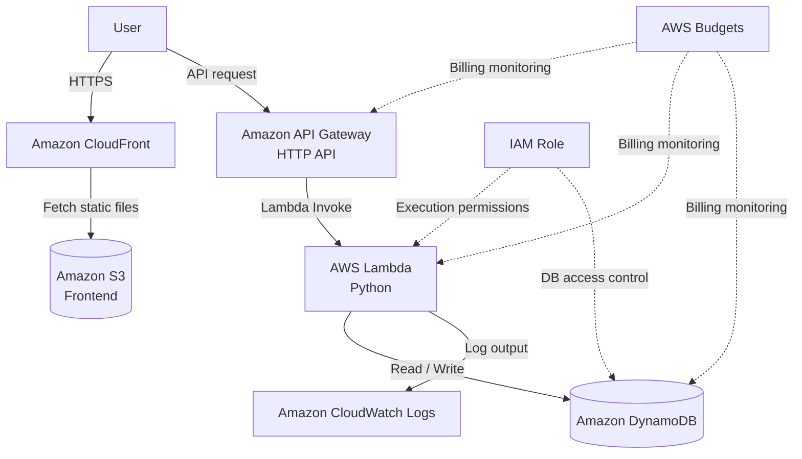

---

## 6.3 Service Configuration

| AWS service | Purpose | Reason for selection |
|---|---|---|
| API Gateway | Entry point for frontend API calls | Expose a simple, low-cost HTTP API |
| Lambda | Contact submission and data retrieval | Executes only when needed, avoiding always-on costs |
| DynamoDB | Store contact, question, and terminology data | Works well with serverless architectures and supports low-cost small-scale operation |
| CloudWatch Logs | Inspect Lambda logs | Required for error investigation and operational monitoring |
| IAM Role | Manage Lambda execution permissions | Implement least privilege |

---

## 6.4 API Processing Flow: Contact Submission

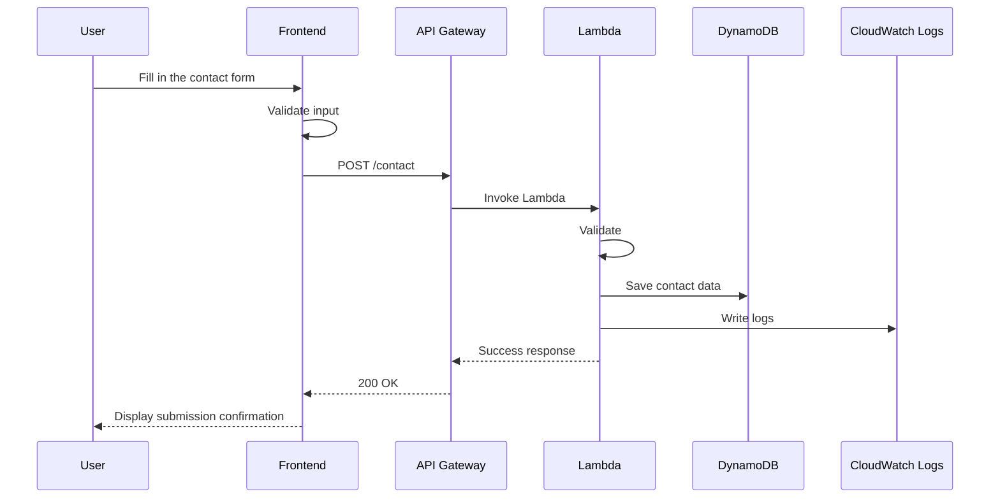

---

## 6.5 API Processing Flow: Practice-Question Retrieval

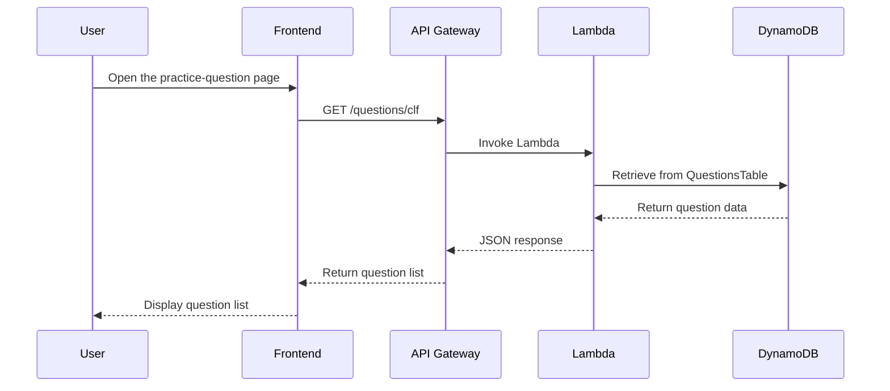

---

## 6.6 API Design Overview

| Method | Path | Purpose | MVP |
|---|---|---|---|
| POST | /contact | Submit a contact inquiry | In scope |
| GET | /terms | Retrieve terminology list | Optional |
| GET | /terms/{termId} | Retrieve terminology detail | Optional |
| GET | /questions/clf | Retrieve CLF question list | Optional |
| GET | /questions/{questionId} | Retrieve question detail | Optional |
| GET | /architectures | Retrieve architecture diagram list | Future |
| POST | /answers | Save answer history | Future |

---

## 6.7 What Phase 2 Enables

| Item | Details |
|---|---|
| Contact persistence | Save user contact submissions in DynamoDB |
| API implementation experience | Demonstrate API Gateway + Lambda + DynamoDB implementation experience |
| Operational monitoring | Inspect errors in CloudWatch Logs |
| Extensibility | Easily extend to saved learning history and per-user features |
| SAA preparation | Explain a serverless API architecture through a personal project |

---

## 7. Phase 3: Custom Domain and Monetization Preparation Architecture

## 7.1 Architecture Overview

In Phase 3, plan for a custom domain, HTTPS, Google Search Console, Google Analytics, and AdSense to support SEO, advertising revenue, and greater credibility.

On AWS, use Route 53 and ACM.

---

## 7.2 Architecture Diagram

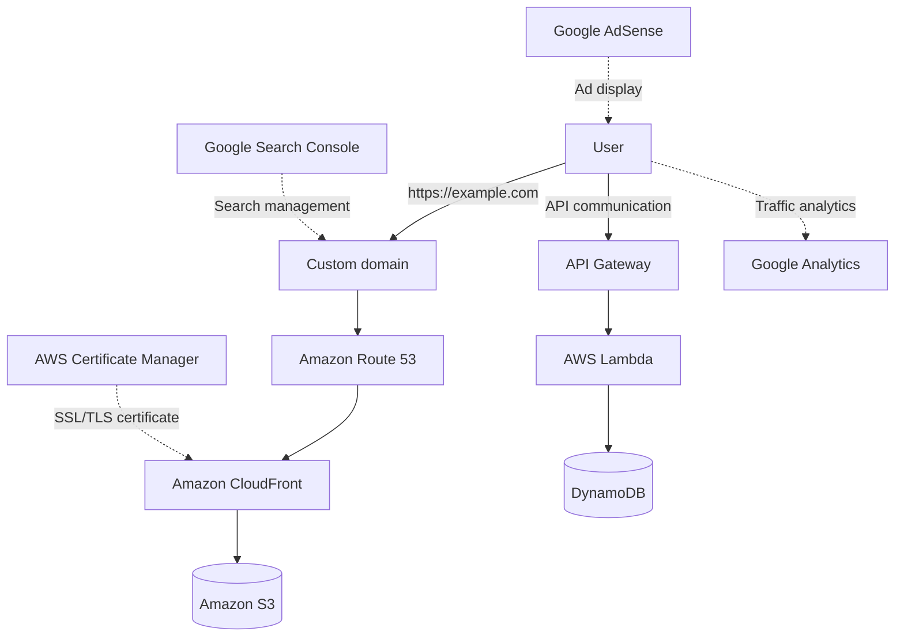

---

## 7.3 Service Configuration

| Service | Purpose | Notes |
|---|---|---|
| Route 53 | Custom-domain DNS management | Configure when using a custom domain |
| ACM | Issue HTTPS certificates | Generally issue in us-east-1 when used with CloudFront |
| CloudFront | HTTPS delivery | Associate the custom domain and certificate |
| Google Search Console | Inspect search performance | Service outside AWS |
| Google Analytics | Traffic analytics | Service outside AWS |
| Google AdSense | Advertising revenue | Service outside AWS |

---

## 7.4 Custom Domain Setup Flow

```text
1. Obtain a domain
2. Create a Hosted Zone in Route 53
3. Issue an SSL/TLS certificate in ACM
4. Configure the custom domain and certificate in CloudFront
5. Point an A record or Alias record in Route 53 to CloudFront
6. Verify that the site is accessible over HTTPS
7. Register with Search Console
8. Submit the sitemap
9. Configure Analytics and AdSense
```

---

## 7.5 Phase 3 Considerations

| Consideration | Details |
|---|---|
| Domain cost | A custom domain may incur costs separate from the AWS Free Tier |
| Route 53 cost | A Hosted Zone may incur a monthly charge, so costs may not be completely zero |
| AdSense review | Requires article quantity, originality, site operator information, and a privacy policy |
| Certificate Region | Note that ACM certificates for CloudFront are managed in us-east-1 |

---

## 8. Phase 4: Learning Application Architecture

## 8.1 Architecture Overview

In Phase 4, extend the information site into a learning-management application.

Add the following features.

- User registration
- Login
- Saved learning history
- Accuracy rate display
- Review questions
- Weakness analysis
- Daily question notifications
- Foundation for paid features

---

## 8.2 Architecture Diagram

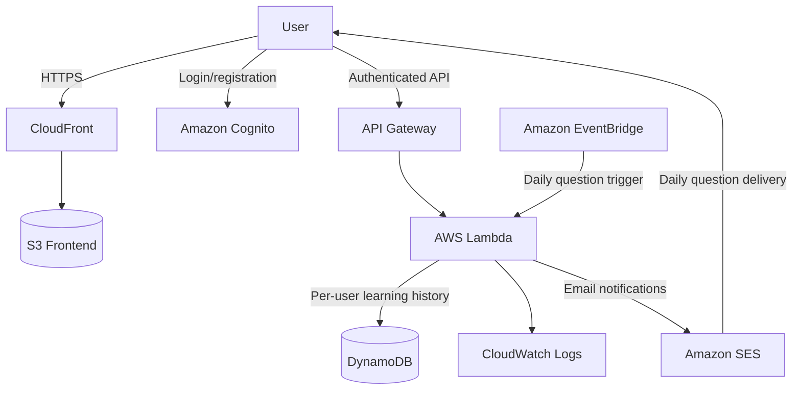

---

## 8.3 Authentication and Authorization Flow

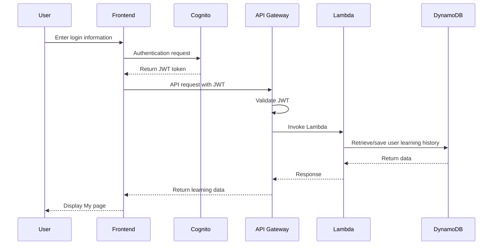

---

## 8.4 Learning-History Persistence Flow

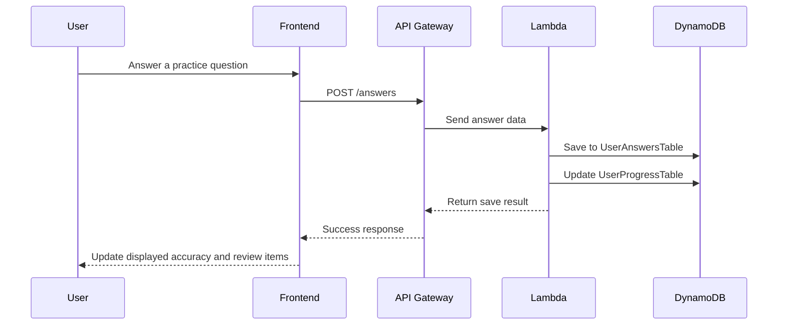

---

## 8.5 Additional Phase 4 Services

| AWS service | Purpose | Reason for selection |
|---|---|---|
| Cognito | User authentication | AWS-managed implementation of login, JWT authentication, and user management |
| EventBridge | Scheduled execution | Supports daily question notifications, periodic aggregation, and maintenance |
| SES | Send email | Supports daily question delivery and contact notifications |
| DynamoDB | Store learning history | Suitable for per-user answer history and accuracy rates |

---

## 9. Data Store Design Overview

## 9.1 DynamoDB Table List

| Table name | Purpose | Phase |
|---|---|---|
| TermsTable | AWS terminology data | Phase 2 onward |
| QuestionsTable | Practice-question data | Phase 2 onward |
| ContactsTable | Contact data | Phase 2 |
| UserAnswersTable | User answer history | Phase 4 |
| UserProgressTable | Learning-progress aggregates | Phase 4 |
| DailyQuestionTable | Daily question delivery data | Phase 4 |

---

## 9.2 ContactsTable

| Attribute | Type | Contents |
|---|---|---|
| contactId | String | Contact ID. UUID |
| createdAt | String | Submission timestamp |
| name | String | Name |
| email | String | Email address |
| subject | String | Subject |
| message | String | Message |
| status | String | new / read / done |

### Proposed Partition Key

| Key | Value |
|---|---|
| Partition Key | contactId |

---

## 9.3 QuestionsTable

| Attribute | Type | Contents |
|---|---|---|
| questionId | String | Question ID. Example: clf-001 |
| exam | String | CLF-C02 / SAA-C03 |
| category | String | Question category |
| difficulty | String | easy / normal / hard |
| question | String | Question text |
| choices | List | Choices |
| answer | Number | Correct answer number |
| explanation | String | Explanation |
| relatedServices | List | Related AWS services |
| updatedAt | String | Update timestamp |

### Proposed Partition Key

| Key | Value |
|---|---|
| Partition Key | questionId |

### Proposed GSIs

| Index | Partition Key | Purpose |
|---|---|---|
| ExamCategoryIndex | exam | Retrieve questions by exam |
| CategoryIndex | category | Retrieve questions by category |

---

## 9.4 UserAnswersTable

| Attribute | Type | Contents |
|---|---|---|
| userId | String | Cognito user ID |
| answerId | String | Answer ID |
| questionId | String | Question ID |
| selectedChoice | Number | Selected answer |
| isCorrect | Boolean | Correctness |
| answeredAt | String | Answer timestamp |

### Proposed Key Design

| Key | Value |
|---|---|
| Partition Key | userId |
| Sort Key | answeredAt#questionId |

---

## 9.5 UserProgressTable

| Attribute | Type | Contents |
|---|---|---|
| userId | String | Cognito user ID |
| exam | String | Exam |
| totalAnswered | Number | Number answered |
| correctCount | Number | Number correct |
| accuracy | Number | Accuracy rate |
| weakCategories | List | Weak categories |
| updatedAt | String | Update timestamp |

### Proposed Key Design

| Key | Value |
|---|---|
| Partition Key | userId |
| Sort Key | exam |

---

## 10. Frontend Deployment Design

## 10.1 Build Output Placement

```text
frontend/
├── app/
├── components/
├── contents/
│   ├── terms/
│   ├── comparisons/
│   ├── blog/
│   └── architectures/
├── public/
│   └── images/
└── out/ or dist/
```

Upload the built static files to S3.

```text
S3 Bucket
├── index.html
├── terms/
├── comparisons/
├── questions/
├── architectures/
├── blog/
├── assets/
└── images/
```

---

## 10.2 CloudFront Delivery Design

| Item | Configuration policy |
|---|---|
| Origin | S3 Bucket |
| Viewer Protocol Policy | Redirect HTTP to HTTPS |
| Allowed HTTP Methods | GET, HEAD by default |
| Cache Policy | Enable caching for static files |
| Default Root Object | index.html |
| Error Pages | Configure a 404 page and SPA routing support if needed |
| OAC | Enable it; do not expose S3 directly |

---

## 11. Backend Design Overview

## 11.1 Lambda Design Policy

| Item | Policy |
|---|---|
| Implementation language | Python |
| Execution unit | Separate Lambda functions by feature |
| Logs | Write to CloudWatch Logs |
| Permissions | Grant only minimum necessary permissions for the required DynamoDB tables |
| Environment variables | Configure table names, allowed Origins, etc. |
| Timeout | Keep it short to prevent unnecessary execution time |

---

## 11.2 Lambda Function List

| Lambda name | Purpose | Phase |
|---|---|---|
| contact-submit-function | Save contact submissions | Phase 2 |
| get-terms-function | Retrieve terminology list/detail | Phase 2 onward |
| get-questions-function | Retrieve question list/detail | Phase 2 onward |
| submit-answer-function | Save answer history | Phase 4 |
| get-progress-function | Retrieve learning progress | Phase 4 |
| daily-question-function | Deliver a daily question | Phase 4 |

---

## 11.3 API Gateway Design Policy

| Item | Policy |
|---|---|
| API type | HTTP API by default |
| CORS | Allow only the frontend domain |
| Authentication | None in the MVP. Use a Cognito JWT Authorizer in Phase 4 |
| Rate limiting | Configure as needed |
| Logs | Enable the minimum necessary logging |

---

## 12. CI/CD Architecture

## 12.1 MVP Deployment Policy

Manual deployment is acceptable initially for the MVP.

```text
1. Build locally
2. Upload to S3
3. Invalidate the CloudFront cache
4. Verify functionality
```

However, move to automated GitHub Actions deployment early to increase portfolio value.

---

## 12.2 Automated Deployment Diagram

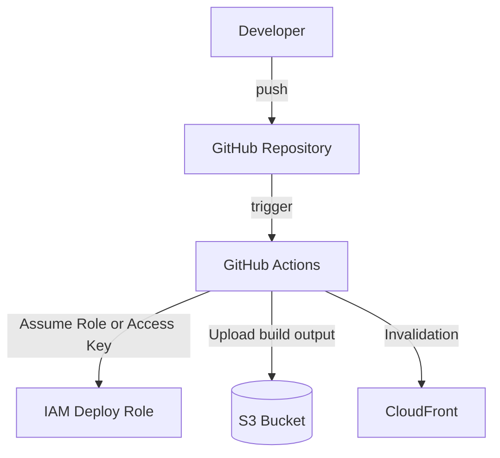

---

## 12.3 GitHub Actions Processing

```text
1. Push to the main branch
2. Install dependencies
3. Lint / Type Check
4. Build
5. Upload to S3
6. Run CloudFront Invalidation
```

---

## 12.4 Deployment Permissions

Grant GitHub Actions only the following permissions.

| Permission | Purpose |
|---|---|
| s3:PutObject | Upload files |
| s3:DeleteObject | Delete old files |
| s3:ListBucket | Inspect the bucket |
| cloudfront:CreateInvalidation | Invalidate the cache |

Do not grant unnecessary AdministratorAccess.

---

## 13. Security Design

## 13.1 S3 Security

| Item | Policy |
|---|---|
| Public Access | Block |
| Delivery path | CloudFront only |
| OAC | Enable |
| Bucket Policy | Allow access only from the CloudFront Distribution |
| Versioning | Optional. Consider enabling to protect against accidental deletion |

---

## 13.2 API Security

| Item | Policy |
|---|---|
| CORS | Restrict allowed Origins to the production domain |
| Input validation | Always perform it in Lambda too |
| Character limits | Set upper limits for the contact message and similar fields |
| Rate limiting | Consider for spam prevention |
| Authentication | Not needed in the MVP. Introduce Cognito when saving learning history |

---

## 13.3 IAM Design

| Target | Permission policy |
|---|---|
| Lambda execution role | Minimum Read/Write permissions for the relevant DynamoDB tables |
| GitHub Actions role | S3 deployment and CloudFront Invalidation only |
| Developer IAM user | Enable MFA and avoid routine use of AdministratorAccess |
| CloudWatch Logs | Permit only Lambda log writes |

---

## 13.4 Secret Management

| Information | Management method |
|---|---|
| AWS access keys | Manage with GitHub Secrets or OIDC |
| API keys | Do not commit to GitHub |
| Environment variables | Configure as Lambda environment variables |
| Future external API keys | Consider Secrets Manager or SSM Parameter Store |

---

## 14. Monitoring and Logging Design

## 14.1 CloudWatch Logs

| Target | Log contents |
|---|---|
| contact-submit-function | Contact submission success/failure and validation errors |
| get-questions-function | Question retrieval requests and retrieval failures |
| submit-answer-function | Answer persistence success/failure |
| daily-question-function | Delivery success/failure |

---

## 14.2 CloudWatch Metrics

Metrics to inspect:

- Lambda Errors
- Lambda Duration
- Lambda Invocations
- API Gateway 4XX / 5XX
- DynamoDB Read / Write usage
- CloudFront Requests

---

## 14.3 Alert Policy

At minimum, configure the following in the MVP.

| Alert | Condition |
|---|---|
| Billing alert | Monthly charges exceed the configured amount |
| Lambda errors | Consecutive errors occur within a given period |
| API 5XX | API Gateway 5XX responses increase |

Require AWS Budgets initially, and add CloudWatch Alarms from Phase 2 onward.

---

## 15. Cost Design

## 15.1 Cost Minimization Policy

| Policy | Details |
|---|---|
| Do not use EC2 | Avoid always-on costs |
| Do not use RDS | Use DynamoDB for the small-scale MVP |
| Do not use NAT Gateway | Avoid its tendency to incur fixed costs |
| Do not use ALB | Use API Gateway for serverless APIs |
| Primarily static delivery | Deliver inexpensively with S3 + CloudFront |
| Limit log retention | Prevent CloudWatch Logs from growing excessively |
| Compress images | Reduce S3 storage and transfer volumes |

---

## 15.2 Treatment of Services with High Billing Risk

| Service | Policy |
|---|---|
| NAT Gateway | Do not use |
| RDS | Do not use in the MVP |
| EC2 | Do not keep always running |
| ALB | Do not use in the MVP |
| Elastic IP | Do not use |
| CloudWatch Logs | Configure retention |
| Route 53 | Use only with a custom domain |

---

## 15.3 AWS Budgets Configuration Policy

| Item | Configuration policy |
|---|---|
| Budget type | Cost Budget |
| Period | Monthly |
| Notifications | Email notifications |
| Threshold | Set low |
| Scope | All AWS services |

---

## 16. Availability and Fault-Tolerance Design

## 16.1 Static Site

| Item | Details |
|---|---|
| S3 | Store static files in highly durable object storage |
| CloudFront | Improve availability and rendering speed with edge caching |
| Static HTML | Keep articles and terminology pages accessible during API failures |

---

## 16.2 API

| Item | Details |
|---|---|
| Lambda | Managed execution platform eliminates server management |
| API Gateway | Use as a managed API entry point |
| DynamoDB | Use as managed NoSQL |
| Error handling | Show users clear messages for API errors |

---

## 16.3 MVP Trade-offs

Do not implement a rigorous multi-Region architecture or advanced DR design in the MVP.

Reasons:

- It would overengineer a solo-developed portfolio project
- It would increase costs
- Prioritize publishing and learning value first

However, explain Multi-AZ, multi-Region, and DR architectures separately in articles and diagrams as SAA learning content.

---

## 17. Backup and Recovery Design

## 17.1 S3

| Item | Policy |
|---|---|
| Source management | Manage source data in GitHub |
| Recovery method | Rebuild and redeploy from GitHub |
| Versioning | Optional. Enable if importance increases |

---

## 17.2 DynamoDB

| Item | Policy |
|---|---|
| Contact data | Export as needed |
| Question and terminology data | Treat JSON/Markdown in GitHub as the source of truth |
| Learning history | Consider PITR from Phase 4 onward |

---

## 18. Environment Separation Design

## 18.1 MVP Policy

Start the MVP with only a production environment to reduce costs.

However, design directories and configuration values with future environment separation in mind.

---

## 18.2 Future Environments

| Environment | Purpose |
|---|---|
| local | Local development |
| dev | Testing environment |
| prod | Production environment |

---

## 18.3 Naming Examples

| Resource | dev | prod |
|---|---|---|
| S3 Bucket | aws-cert-lab-dev | aws-cert-lab-prod |
| Lambda | contact-submit-dev | contact-submit-prod |
| DynamoDB | QuestionsTableDev | QuestionsTableProd |
| API Gateway | aws-cert-api-dev | aws-cert-api-prod |

---

## 19. IaC Policy

## 19.1 Initial Policy

Manual setup in the AWS Management Console is acceptable in Phase 1.

Reasons:

- Understand each service's configuration screens as an AWS beginner
- Align well with CLF study
- Prioritize reaching publication first

---

## 19.2 Medium-Term Policy

Consider converting to IaC from Phase 2 onward.

Candidates:

| Tool | Characteristics |
|---|---|
| AWS SAM | Works well with serverless architectures such as Lambda/API Gateway/DynamoDB |
| Terraform | Supports platforms beyond AWS and has strong portfolio value |
| AWS CDK | Define AWS resources in TypeScript/Python |

---

## 19.3 Recommended Policy

AWS SAM is recommended initially for this product.

Reasons:

- Works well with Lambda, API Gateway, and DynamoDB architectures
- Directly supports serverless learning
- Easy to connect to SAA study material
- Fits the scale of solo development

Migrating to Terraform later, or creating a Terraform version on a separate branch, would further increase portfolio value.

---

## 20. Recommended Directory Structure

```text
aws-cert-roadmap-lab/
├── frontend/
│   ├── app/
│   ├── components/
│   ├── contents/
│   │   ├── terms/
│   │   ├── comparisons/
│   │   ├── questions/
│   │   ├── architectures/
│   │   └── blog/
│   ├── public/
│   └── package.json
│
├── backend/
│   ├── functions/
│   │   ├── contact_submit/
│   │   ├── get_terms/
│   │   ├── get_questions/
│   │   └── submit_answer/
│   ├── shared/
│   └── requirements.txt
│
├── infra/
│   ├── sam-template.yaml
│   └── README.md
│
├── docs/
│   ├── project-proposal.md
│   ├── requirements-definition.md
│   ├── screen-transition-design.md
│   ├── aws-architecture-design.md
│   └── diagrams/
│
├── .github/
│   └── workflows/
│       └── deploy.yml
│
└── README.md
```

---

## 21. AWS Architecture Description for the README

Use the following explanation in the GitHub README.

```text
This product is a web learning site for AWS Cloud Practitioner / SAA learners.
Its infrastructure uses an AWS serverless architecture: S3 + CloudFront serves the static site, while API Gateway + Lambda + DynamoDB processes contact submissions and question data.

By avoiding always-on servers and using the AWS Free Tier and pay-as-you-go services, the architecture minimizes operating costs at low traffic volumes.

S3 is not exposed directly. CloudFront Origin Access Control restricts access to CloudFront only.
```

---

## 22. Points to Explain in Interviews

## 22.1 Why Use S3 + CloudFront?

- Suitable for publishing static sites
- Low-cost publishing without EC2
- CloudFront provides HTTPS delivery and caching
- Secure delivery without exposing S3 directly

## 22.2 Why Use Lambda + API Gateway?

- Contact submissions and data retrieval need processing only when requested
- No need to keep a server running continuously
- Fits the scale of solo development
- Demonstrates practical serverless architecture experience

## 22.3 Why Use DynamoDB?

- Stores structured data such as terminology, questions, contact submissions, and learning history
- Works well with serverless architectures
- Helps keep costs low at small traffic volumes
- Provides material for explaining NoSQL design, an important SAA topic

## 22.4 Why Not Use RDS?

- A relational database is not essential for the MVP
- RDS tends to create fixed costs for small solo-developed projects
- DynamoDB adequately handles questions, terminology, and learning history
- Cost optimization is a priority

## 22.5 Why Not Use NAT Gateway?

- The MVP has no requirement for outbound communication from private subnets within a VPC
- NAT Gateway tends to incur fixed costs
- An architecture centered on Lambda, DynamoDB, and API Gateway does not require a complex VPC configuration

---

## 23. Selected and Rejected Architectures

## 23.1 Selected Architectures

| Architecture | Reason |
|---|---|
| S3 + CloudFront | Well suited to static site publishing and low cost |
| API Gateway + Lambda | Suitable for lightweight APIs and serverless operation |
| Lambda + DynamoDB | Suitable for storing contact submissions, questions, and learning history |
| Cognito | Suitable for future login functionality |
| EventBridge | Suitable for future daily question delivery |
| CloudWatch Logs | Required for operational monitoring and incident investigation |
| AWS Budgets | Essential for preventing unexpected charges |

---

## 23.2 Rejected Architectures

| Architecture | Reason for rejection |
|---|---|
| Always-on EC2 | Prone to fixed costs and excessive for the MVP |
| RDS | Unnecessary in the MVP, with fixed-cost risk |
| NAT Gateway | Unnecessary in the MVP, with high billing risk |
| ALB | API Gateway is sufficient for a serverless API |
| ECS/EKS | Excessive for a solo-developed MVP |
| Multi-Region architecture | High cost and operational burden for the MVP |

---

## 24. Final Recommended Architecture

## 24.1 Recommended MVP Architecture

The following architecture is recommended for the MVP.

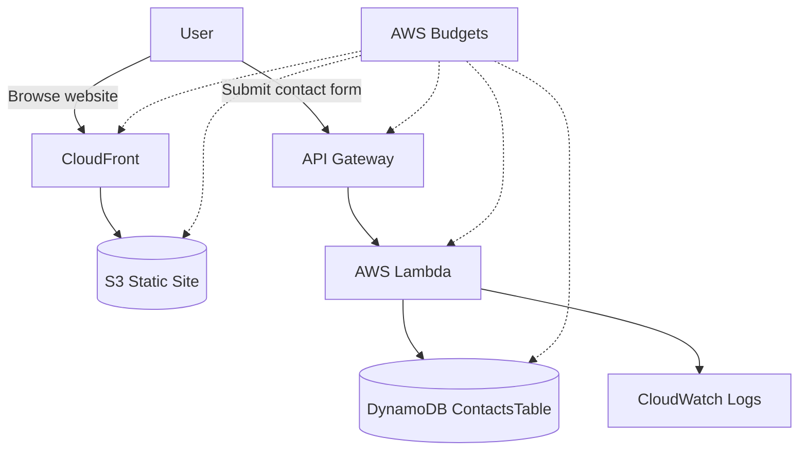

---

## 24.2 MVP Responsibilities

| Area | Responsible service |
|---|---|
| Web delivery | S3 + CloudFront |
| API entry point | API Gateway |
| API processing | Lambda |
| Contact persistence | DynamoDB |
| Logs | CloudWatch Logs |
| Permission management | IAM |
| Billing monitoring | AWS Budgets |

---

## 24.3 Future Complete Architecture

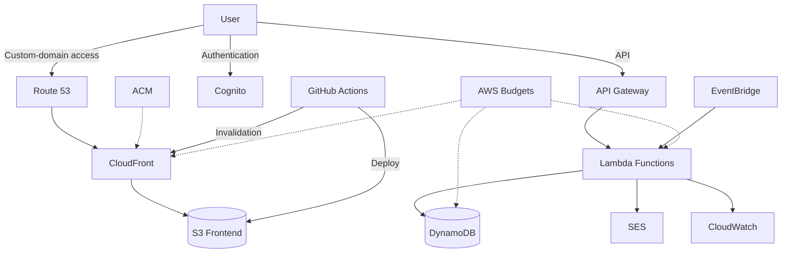

---

## 25. Implementation Order

## 25.1 AWS Setup Order

```text
1. Configure AWS Budgets
2. Create the S3 bucket
3. Place the static site build output in S3
4. Create the CloudFront Distribution
5. Configure OAC
6. Configure the S3 Bucket Policy
7. Verify display through CloudFront
8. Create API Gateway
9. Create Lambda
10. Create DynamoDB ContactsTable
11. Connect the contact API
12. Inspect CloudWatch Logs
13. Configure GitHub Actions deployment
14. Automate CloudFront Invalidation
15. Introduce a custom domain
16. Prepare Search Console / Analytics / AdSense
```

---

## 25.2 Mandatory First Steps

Always perform the following tasks first.

| Item | Reason |
|---|---|
| Configure AWS Budgets | Prevent unexpected charges |
| Configure MFA | Protect the AWS account |
| Organize IAM users/roles | Avoid routinely using the root user |
| Check S3 Public Access Block | Prevent unintended public access |
| Configure CloudWatch Logs retention | Prevent charges caused by excessive log growth |

---

## 26. Acceptance Criteria

## 26.1 Phase 1 Acceptance Criteria

| ID | Criterion |
|---|---|
| AC-AWS-001 | Static site files are stored in S3 |
| AC-AWS-002 | The site is accessible through CloudFront |
| AC-AWS-003 | The S3 bucket is not directly public |
| AC-AWS-004 | AWS Budgets is configured |
| AC-AWS-005 | An architecture diagram is published in the GitHub README |

---

## 26.2 Phase 2 Acceptance Criteria

| ID | Criterion |
|---|---|
| AC-AWS-006 | API Gateway can invoke Lambda |
| AC-AWS-007 | Lambda can save data in DynamoDB |
| AC-AWS-008 | Data can be submitted through the contact form |
| AC-AWS-009 | Lambda logs can be inspected in CloudWatch Logs |
| AC-AWS-010 | The Lambda IAM Role is configured with least privilege |

---

## 26.3 Phase 3 Acceptance Criteria

| ID | Criterion |
|---|---|
| AC-AWS-011 | The site is accessible through a custom domain |
| AC-AWS-012 | Content is served over HTTPS |
| AC-AWS-013 | Search Console registration is complete |
| AC-AWS-014 | The sitemap has been submitted |

---

## 26.4 Phase 4 Acceptance Criteria

| ID | Criterion |
|---|---|
| AC-AWS-015 | Users can register and log in with Cognito |
| AC-AWS-016 | Authenticated APIs can be called |
| AC-AWS-017 | Learning history can be saved in DynamoDB |
| AC-AWS-018 | My page can display accuracy rates |
| AC-AWS-019 | EventBridge can run scheduled processing |

---

## 27. Conclusion

The product's AWS architecture is serverless, based on static site delivery with S3 + CloudFront and supplemented with API Gateway + Lambda + DynamoDB as needed.

The MVP does not use services prone to fixed costs, such as EC2, RDS, NAT Gateway, or ALB. This enables a low-cost published portfolio while using the AWS Free Tier.

Ultimately, add Cognito login, DynamoDB learning-history persistence, EventBridge daily question delivery, SES email notifications, and Route 53 + ACM custom-domain/HTTPS support to extend the learning content site into a learning application.

This architecture enables the following simultaneously.

- Put AWS certification learning into practice
- Present a serverless architecture as a portfolio
- Low-cost operation
- Development into an SEO content site
- Future advertising revenue, learning-material sales, and SaaS expansion

Not only as an AWS certification learning site,
